# Spidey Sense

A wearable "spidey sense": eye-tracking glasses see what's around you, Claude notices what **you haven't looked at**,
and a haptic Dot on your body taps you, with Spidey's voice in your ear saying why. Hands-free; set up by talking to it.

Hackathon project (Interface Hackathon, Oct 2026).

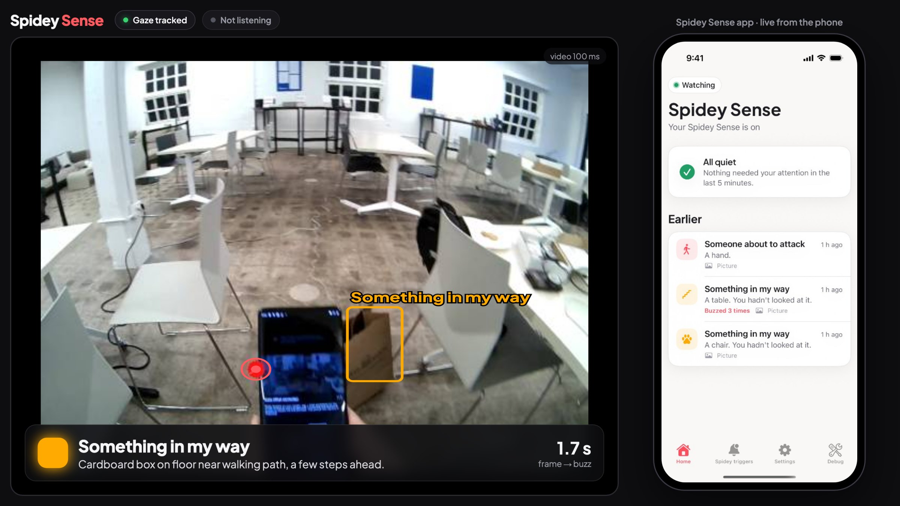

*Demo screen (`/demo`): left, what the glasses see (coral ring = your gaze, boxes = what Haiku found, banner = the buzz
with Haiku's reason and frame→buzz time); right, the phone app mirrored live over Wi-Fi.*

## What it does

- **Gaze-aware triggers in plain English.** "A lion I haven't noticed", "someone about to attack me", "something in my
  way". Each trigger buzzes *only if you haven't noticed it*, *when you look at it*, or *always*. "Noticed" = your real
  gaze rested on Haiku's box for ~0.2 s (a glance doesn't count); a 3 s notice memory keeps it quiet right after.
- **~1 s from sight to touch.** One Claude Haiku call per tick (5 overlapping calls, a new frame every 0.25 s, streamed);
  a gaze cache re-checks gaze against Haiku's boxes on every frame, so looking away fires in ~0.25 s.
- **Over time, relative only.** Temporal triggers compare 3 labelled frames (closer / same / farther, touching) and a
  trend layer (gap in body-heights, looming). Time to contact comes from how fast a box grows. No absolute distances.
- **Haptics.** DataFeel Dot over Bluetooth (El Jefe hub): vibration patterns, RGB colour per trigger, thermal; 117 ms
  median trigger; health checks, auto baseline, thermal safety.
- **Voice (ElevenLabs).** Spidey says why it buzzed (eleven_flash_v2_5, 0.3–0.8 s), in your AirPods or the phone.
  *Hold to tell Spidey*: say "warn me if a dog comes near me" → scribe_v2 → Haiku drafts the trigger → you confirm.
- **Hearing.** The glasses' microphone → ElevenLabs speech-to-text with sound tags (horn, siren, shouting) → "Heard
  (last 5 s): …" goes into the same Haiku call, so a trigger can use sight and sound. Still one detection path.
- **Oura heart rate.** Your real ring via Oura's cloud API (OAuth): heart rate on Home and a "heart racing" trigger
  (readings arrive minutes late; history never buzzes). Live BLE via `open_oura` is also built (needs re-pairing).
- **Walking.** "Only while I'm walking" per trigger (Neon IMU step detection; unknown never blocks).
- **iOS app** for everyone: what buzzed and why, collapsed repeats, step-by-step trigger wizard, voice, Debug tools.
- **Traces for every call**: the exact images Haiku saw, prompt, reply, timings and why each trigger did or didn't fire.

## The app

| Home | Why it buzzed | Talk to Spidey | Spidey heard you |
|:-:|:-:|:-:|:-:|
| 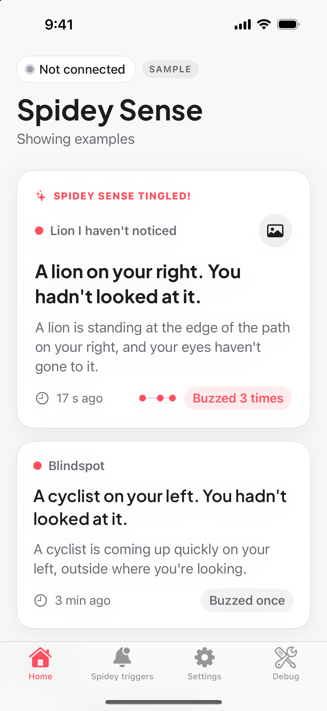 | 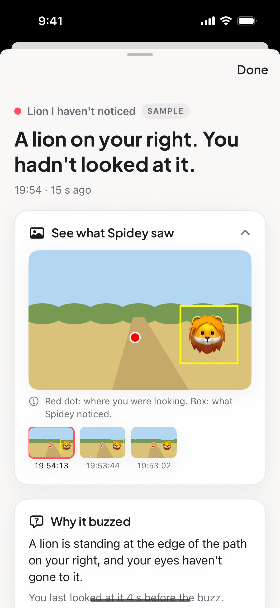 | 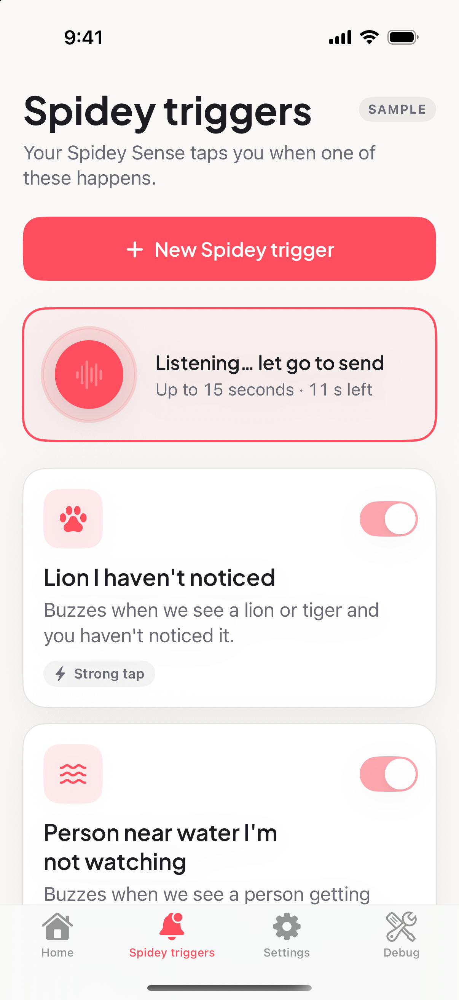 | 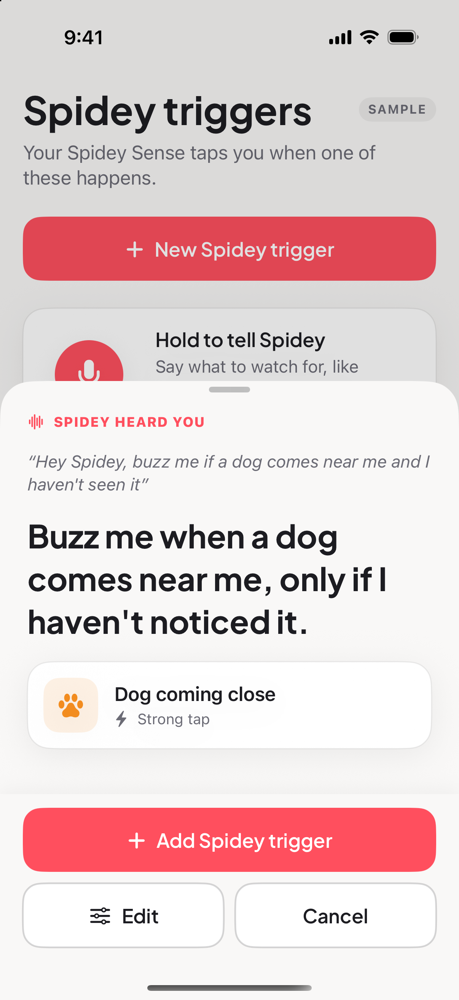 |
| **Repeats collapse** | **New trigger: what** | **When to warn you** | **Only while walking** |
|  | 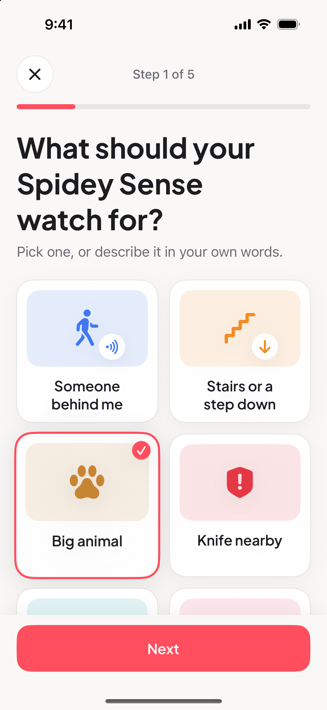 | 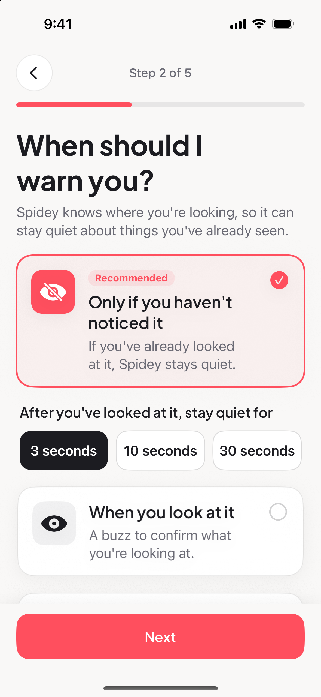 | 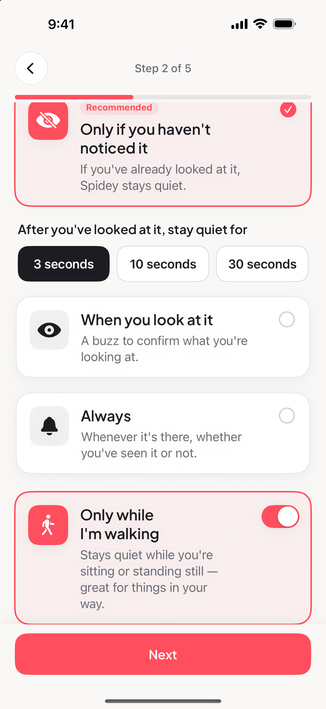 |
| **Summary** | **Spidey Sense improved!** | **Spidey's voice** | **Debug: live decisions** |
| 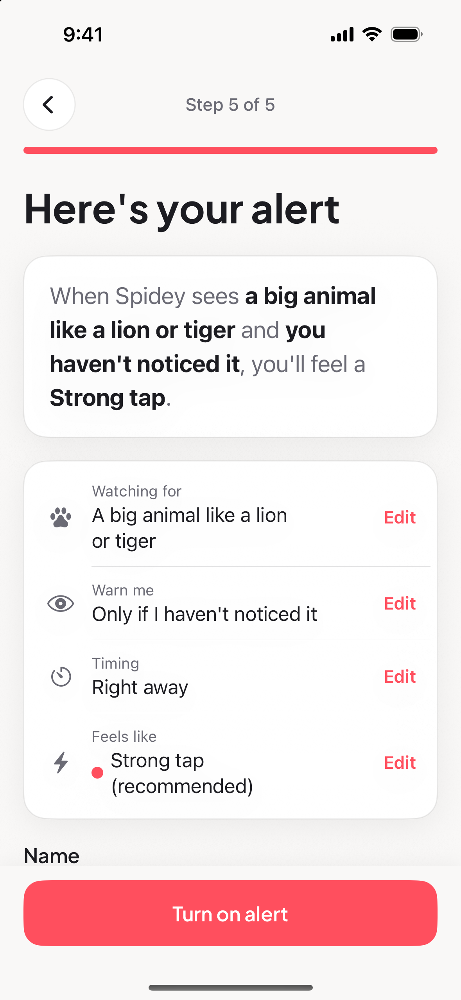 | 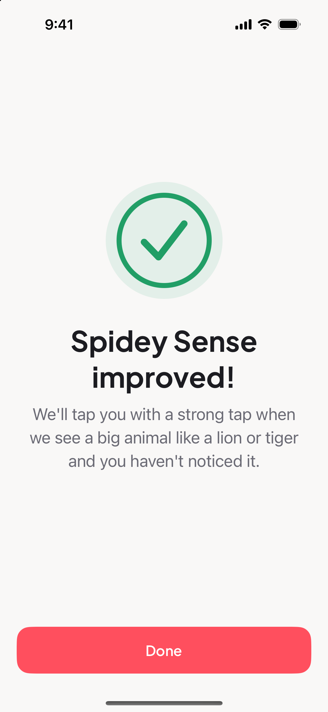 | 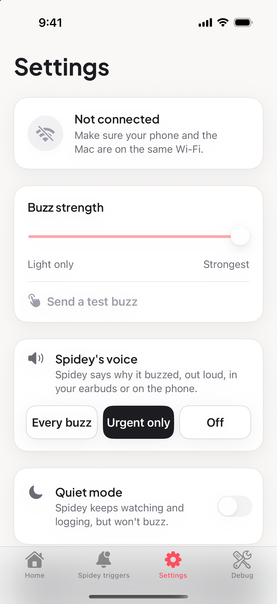 | 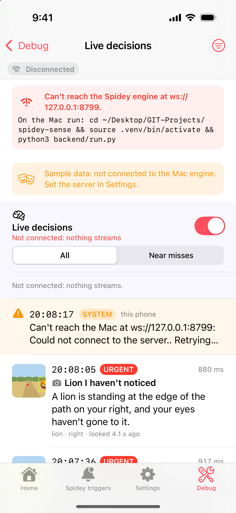 |

More (large text, iPhone SE, photo view, Oura on Home, a 34 s screen recording `flow.mp4`): `docs/screenshots/redesign/`.

## Architecture

```
 WORN ON YOU                                   ON THE TABLE (MacBook)                          YOUR PHONE
 ───────────                                   ──────────────────────                          ──────────
 Pupil Labs Neon ──USB-C── Companion phone ─Wi-Fi─▶ source   (sources.py: video, gaze, IMU, mic)
   scene camera, gaze,      (5 GHz hotspot)         │  Frame(image, gaze) · walking · heard audio
   IMU, microphone                                  │                       └─▶ hearing.py ─▶ ElevenLabs STT
                                                    ▼                                        (sound tags)
                                                  detector (detectors.py)  ◀── "Heard (last 5 s): …"
                                                    │  ONE Claude Haiku call: hazard + every custom trigger
                                                    ▼  (match, urgency, bbox, reason), streamed
                                                  gaze cache + memory + rules (gaze_cache.py, rules.py)
                                                    │  noticed? walking? time to contact? stale?
 Oura ring ─▶ phone app ─▶ Oura cloud ─────────────▶ heart.py (heart racing)
                                                    ▼
 DataFeel Dot ──chain── El Jefe ◀──Bluetooth LE─── sink (sinks.py → haptics/dots)
   vibration · RGB · thermal                        │
                                                    ├─▶ voice.py ─▶ ElevenLabs TTS ─▶ "speech" ─┐
                                                    └──WebSocket :8765 (protocol.md) ◀──────────┴─▶ iOS app
                                                       events, triggers, voice drafts, status      (ios/SpideySense)
                                                       ◀── mirror.frame (app screen, ReplayKit)
 Trace viewer :8096 (trace_viewer.py): /  call cards · /live  live scene · /demo  demo screen (scene + phone)
 Haptic Playground (backend/playground): web UI :8080 to try every Dot affordance by hand.
```

Every stage is swappable in `backend/configs/*.yaml` (`type: fake | neon`, `fake | vlm`, `console | datafeel | datafeel-ble`).

| Folder | What |
|---|---|
| `backend/` | Python package `spidey` (engine, rules, sources, detectors, sinks, WebSocket server), `run.py`, `configs/`, `playground/` |
| `haptics/` | DataFeel Dots: `spidey_haptics.py` (patterns, CLI), `dots/ble.py` (Bluetooth transport), `dots/fastfire.py` (2-write triggers), tests, `vendor/datafeel-python` (MIT SDK) |
| `neon/` | `neon_app`: Pupil Labs Neon gaze + scene sources (Capture over USB, or Companion phone over Wi-Fi) |
| `vlm/` | vision test scenes, latency report, desk-test results (detector code is `backend/spidey/detectors.py`) |
| `backend/desk_test/` | desk test page (Commons images, see its `CREDITS.md`; synthetic lake scene), simulator harness, offline checks |
| `radar/` | radar sense docs + calibration; `adapter/` = radar-lab's adapter + protocol v2 (reference) |
| `ios/` | SwiftUI app (light, consumer-style): Home / Spidey triggers (step-by-step wizard) / Settings, plus a Debug tab with the technical screens (zero-config connect) |
| `docs/` | `STATUS.md` (current state, one page), `protocol.md` (app ↔ engine WebSocket), `architecture.md`, `BUILD_LOG.md` (everything, timestamped), `deck/` (slides) |
| `scripts/` | setup, API key, playground, Bluetooth test/latency, `traces.sh` (trace viewer :8096) |

## Quickstart

```bash
cd ~/Desktop/GIT-Projects/spidey-sense
./scripts/setup.sh               # uv venv on Python 3.12 + editable installs
source .venv/bin/activate
./scripts/set_api_key.sh         # Anthropic key → .env (hidden input, gitignored)
# optional, in the same .env (never committed):  ELEVENLABS_API_KEY=…  (voice + hearing)
#                                                 OURA_CLIENT_ID=… OURA_CLIENT_SECRET=…  then: python3 tools/oura_oauth.py
#   (Oura app at https://developer.ouraring.com/applications, redirect URI exactly http://localhost:8099/callback;
#    the token is saved 0600 to ~/.config/spidey/oura_token.json and refreshed automatically)

python3 backend/run.py --seconds 10                                           # fakes only, prints cues
python3 backend/run.py --config backend/configs/config.vlm.yaml --seconds 21  # Haiku on test scenes
```

**Bluetooth needs Terminal.app** (or iTerm). macOS only grants Bluetooth to real apps, and a process
started from inside other tools gets killed (exit 134). From Terminal:

```bash
./scripts/ble_test.sh                              # finds DataFeelCE, flashes the Dot green
./scripts/playground.sh                            # Haptic Playground → open the printed URL on your phone
python3 backend/run.py --sink datafeel-ble         # full pipeline buzzing the Dot
./scripts/engine_ble.sh --config backend/configs/config.manual.yaml   # real Dot, nothing auto-fires: drive it from the app
```

Only one program can hold the El Jefe Bluetooth link at a time. Our El Jefe is **DataFeelCE**; other kits at the
venue advertise as DataFeel1E/3A/7E/32/36, and the code only connects on an exact name match.

**Neon (wireless, via the Companion phone).** Glasses plug into the Companion phone; the phone streams scene
video + gaze over Wi-Fi to the Mac (Pupil Labs Real-time API, port 8080). Phone and Mac must be on the same Wi-Fi,
or (easiest, no venue Wi-Fi needed) **turn on the phone's hotspot and join it from the Mac**: the phone is then the
Mac's default gateway, and the check script + engine connect to it automatically (mDNS discovery does NOT work over
the Android hotspot; the gateway IP does). The Mac keeps internet through the hotspot (phone's mobile data) for Haiku.

```bash
./scripts/neon_check.sh                 # finds the phone, prints battery / fps / gaze rate / delay, opens a live view
./scripts/neon_check.sh 192.168.1.23    # if discovery is blocked on venue Wi-Fi: phone IP from the Companion app
./scripts/neon_check.sh --mock          # no device
python3 backend/run.py --config backend/configs/config.neon.yaml              # real Neon + Haiku, console output
python3 backend/run.py --config backend/configs/config.neon.yaml --sink datafeel-ble   # + buzz (Terminal.app)
```
Connection order: `source.host` / the IP argument → the Mac's default gateway (hotspot) → mDNS. On venue Wi-Fi where
discovery is blocked, set `source.host: <phone ip>` in `config.neon.yaml`. Frame timestamps are converted to the
Mac's clock with Pupil Labs Time Echo, so `e2e_ms` in the log is glasses capture → cue.

**Desk tests: attention-aware triggers** (from the app's Senses templates; turn on one at a time):

| Test | Trigger id | Expect |
|---|---|---|
| A: look at a big cat | `big_cat_look` (looking_at) | buzz while looking at the lion/tiger; nothing for the dog/car/house |
| B: lion you haven't noticed | `lion_unnoticed` (unseen, 3 s notice memory) | buzz while reading the text with the lion in view; silent once you look at it |
| C: person approaching water | `person_to_water` (temporal, any) | buzz as the person nears the water edge; nothing while far or walking away |
| D: same, only if you're not watching | `person_to_water_unwatched` (temporal, unseen) | buzz only while you look at the text |
| E: someone behind you (**radar off for now**) | `someone_behind` (radar, within 2 m, ≥ 0.3 m/s) | buzz when someone walks up; walk-bys ignored |

```bash
./scripts/desk_test.sh                     # desk test page on :8095 (lion etc. on the right, text on the left; ?test=C for the lake)
./scripts/engine_ble.sh --config backend/configs/config.desk.yaml          # Neon + Haiku + Dot (Terminal.app); radar OFF for now
# radar later: start ~/Downloads/radar-lab/server.py, then use backend/configs/config.desk_radar.yaml
./scripts/desk_test.sh prerun              # dry runs on simulated scenes + scripted gaze (real Haiku)
./scripts/desk_test.sh check               # offline engine checks
python3 tools/world_eval.py --reps 3      # scored world-sim eval (A–D) → vlm/world_eval_results.md, logs/reports/world_eval.html
```
**Traces: why did (or didn't) it fire?** Every engine run records each Haiku call to `backend/logs/runs/<time>-<config>/`
(the exact JPEGs sent with the gaze dot, prompt, raw reply, timings, tokens, the gaze samples used, and per trigger
fired / why-not; capped at 2000 calls / 500 MB, runs older than 2 days pruned; `trace: {enabled: false}` turns it off).
```bash
./scripts/traces.sh          # viewer: http://localhost:8096/ (calls as cards, filters) and http://localhost:8096/live (live scene, gaze, boxes)
./scripts/traces.sh lan      # same, reachable from the phone / a second screen
```
The desk page posts which picture it shows to the viewer (`/api/truth`), so each card shows the ground truth at the frame and at
decision time. In the app, Log → **Live decisions** streams the same per-call decisions (near misses with a thumbnail).
Results older than `max_result_age_s` (2.5 s) never fire, and `looking_at` needs your gaze still in the box at decision time.
Desk configs set `detector.treat_screens_as_real: true` (Haiku treats the monitor's lion as a real lion).

"Seen" comes from your real gaze history overlapping the object's box (from Haiku), not from Haiku's guess. Over-time
triggers keep only relative signals (the gap in body-heights, looming, closer/same/farther). See `docs/architecture.md`.

**iOS app: zero setup.** Open `ios/SpideySense/SpideySense.xcodeproj` (or `cd ios/SpideySense && xcodegen generate`)
and press Run. Phone and Mac on the same Wi-Fi is the only assumption:
- The app finds the engine by itself: a custom URL (if you set one) → **Bonjour** (the engine advertises
  `_spidey._tcp`) → the Mac's IP stamped into the build → `127.0.0.1` in the simulator. It re-searches after a drop.
- Pressing Run also starts the demo engine (fakes, console) if nothing is listening on 8765. Bluetooth runs still go via Terminal.
- On a real iPhone: the team is preset (F9KC623A2R). Plug in once, pick the iPhone, Run, allow Local Network; tick "Connect via network" in Xcode → Devices for wireless installs. The phone must be on the same Wi-Fi as the Mac (at the venue: the Neon phone's hotspot).

Tabs (light theme, Airbnb-style cards; headings in Plus Jakarta Sans):
- **Home** ("Spidey Sense"): buzzes from the last 5 minutes are big text-first cards ("A lion on your right. You hadn't
  looked at it.", time, "Buzzed 3 times" with a mini timeline); older ones sit in a plain "Earlier" list. Repeat buzzes
  collapse: same trigger id + the same object (main noun of Haiku's `hazard`/`why`), each buzz within 60 s of the group's
  last one (rolling window). A photo button shows what the glasses saw (gaze dot + box); tap a card for the detail sheet
  (snapshot sequence, why it buzzed, buzz timeline, sensor, helpful / not needed feedback, "Technical details" = raw Haiku
  output + event JSON). A speaker glyph shows while Spidey is saying it. At the bottom, quiet context: Oura heart rate
  ("72 bpm · from your Oura ring · 6 min ago"), glasses on, listening. Offline it shows sample data, marked "SAMPLE".
- **Spidey triggers**: one list, active triggers first (yours before built-ins), on/off toggles (long-press: edit / delete),
  "Suggested" templates (incl. "Heart racing" when Oura is connected), and **Hold to tell Spidey** (voice → draft → confirm). **+ New Spidey trigger** opens a one-question-per-screen wizard: what to watch for (picture tiles or your own
  words) → when to warn you (`gaze_mode`: only if you haven't noticed it / when you look at it / always, + notice memory)
  → wait to be sure? (`temporal`) → how it should feel (optional; recommended feel from the answers, "Try it" plays
  `haptic.preset` on the Dot + the phone) → summary sentence + name + "Advanced" (min urgency, cooldown, Dot, raw
  description / radar / heart thresholds) → "Spidey Sense improved!". It sends the same trigger JSON as before.
- **Settings**: connection in plain words, buzz strength, **Spidey's voice** (every buzz / urgent only / off), quiet mode,
  test buzz, stop all, "Show Debug tab", **Demo → Mirror screen to Mac**.
- **Debug** (on by default): pause detection, Devices, Haptics & link check, Live decisions, raw event log, the technical
  trigger editor, and Engine / connection / About.
Screenshots + a short screen recording: `docs/screenshots/redesign/` (`flow.mp4`). Launch-argument hooks for screenshots
(`-tab`, `-openWizard`, `-wizardTile`, `-wizardStep`, `-openEvent`, `-expandPhoto`, `-debugOpen`, `-demoWizard`, `-demoArrive` …)
are listed in the views' `onAppear`.

## Measured so far

| | |
|---|---|
| Dot trigger over USB | 48 ms |
| Dot trigger over Bluetooth, stock SDK (6 writes) | 361 ms median |
| Dot trigger over Bluetooth, `dots/fastfire` (buzz starts after 2 writes) | **117 ms median**, 150 ms worst |
| Bluetooth connect + discover | 4–5 s |
| Claude Haiku 5.5, frame → cue (384 px, streamed early fields, 2 calls in flight) | **0.92 s median, 1.20 s p90** (was 1.28 / 1.41 s); ~3 results/s |
| Neon over phone hotspot: scene+gaze | 1600x1200 @ 9–18 fps, gaze-only 130 Hz; capture→Mac 110–150 ms median (spikes to ~1 s p90) |
| Neon + Haiku through the engine (hotspot) | Haiku 1.1 s median, e2e (glasses capture → cue) 1.6 s median, 1.9 s p90 |
| El Jefe health check (BLE register read) | ~60 ms; app → Mac → Dot link ping ~60 ms |
| Master intensity 0.3, `urgent` via engine over BLE | 253 ms (weaker waveform variants) |
| Desk dry runs A–D (sim scene, scripted gaze, real Haiku, 512 px) | all pass; frame→fire 1.2–1.3 s (single image), 1.5–1.65 s (temporal, 3 images) |
| World-sim A–D (3 reps, real Haiku, gaze cache) | all pass, 0 false alarms; **gaze lands → buzz 0.24 s** (cached boxes), new object → buzz ~1.5 s (Haiku) |
| Neon over the phone hotspot on **5 GHz** | capture→Mac **~90 ms median, ~120 ms p90** (2.4 GHz: 0.5–3 s bursts) |
| Haiku call through the phone's cellular uplink | 1.1–1.7 s median, slow tails 3–5 s (12.5 % packet loss measured); 5 overlapping calls hedge it |
| Obstacle trigger, 56 hand-labelled live frames | Haiku v1 prompt **96 % recall**, 19 % false alarms (Sonnet: same recall, +0.7 s) — `vlm/prompt_ab_obstacles.md` |
| Attack trigger, reworded for recall (replay of missed frames) | 0/14 → **14/14**, 0/8 false alarms |
| ElevenLabs TTS (eleven_flash_v2_5) / STT (scribe_v2, 3 s window) | 0.3–0.8 s / 0.45–0.85 s |
| Voice → drafted trigger (STT + Haiku) | ~2–3 s |
| Radar frame → cue | ~29 ms median (radar-lab) + ~4 ms server→sense; + ~117 ms BLE buzz ≈ 0.15 s |

## Keeping this README current

Every change that adds or changes a feature, command, folder, config option or measurement updates this README
in the same commit, and gets a timestamped entry in `docs/BUILD_LOG.md` (see `CLAUDE.md`).

## Credits

- **DataFeel** devkit Python SDK (MIT), vendored in `haptics/vendor/datafeel-python`. The BLE protocol was identified
  from DataFeel's NuGet packages `Datafeel.NET.BLE` / `CallAndResponse.Transport.Ble`.
- **Pupil Labs** Neon, the Real-time API (`pupil-labs-realtime-api`) and Pupil Capture network API.
- **Anthropic** Python SDK, Claude Haiku 5.5.
- **radar-lab** (radar workstream): `server.py` (Infineon BGT60TR13C via the Infineon Radar SDK), tracking + debounced
  alerts, feed protocol v2 and the Spidey adapter (`radar/adapter/`).
- Desk test images from Wikimedia Commons; the lion is CC BY 2.0 by Kevin Pluck. Full list: `backend/desk_test/CREDITS.md`.
- `bleak`, `minimalmodbus`, `pyserial`, `websockets`, FastAPI, OpenCV.
- **ElevenLabs** text-to-speech (eleven_flash_v2_5) and speech-to-text (scribe_v2) for Spidey's voice and hearing.
- **Oura** API v2 (OAuth) for heart rate; `open_oura` (MIT, github.com/Th0rgal/open_oura) for the live-BLE option
  (`backend/spidey/heart.py`, setup in `docs/oura.md`).
- **Plus Jakarta Sans** (SIL OFL 1.1, Tokotype), the app's heading font: `ios/SpideySense/SpideySense/Fonts/` (with `OFL.txt`).

## Demo screen (Mac, full screen)

`./scripts/traces.sh` (viewer on :8096) + the engine running → open **http://localhost:8096/demo** and go full screen.
- Left 70 %: the Neon scene with the gaze ring + trail, Haiku's boxes (amber = matched, Dot colour = buzzed), a banner on
  every buzz (trigger, Haiku's reason, Dot colour, frame→buzz time) with a glow in the Dot's colour, "Heard: …" when the
  mic catches something, pills for gaze / walking / hearing / Oura heart rate (each hidden when it has nothing real).
- Right 30 %: the iPhone app, mirrored live over Wi-Fi: in the app, Settings → Demo → **Mirror screen to Mac**
  (ReplayKit in-app capture; only Spidey Sense is shared; iOS asks once). ≤ 8 fps while the screen changes, 540 px JPEG.

Demo-day checklist: Companion phone hotspot on **5 GHz**, Mac + iPhone joined to it (Android hotspots block Bonjour: set
`ws://<mac ip>:8765` once in the app under Debug → Engine); El Jefe charged and **unplugged before** starting the engine;
Companion app microphone on (for hearing); open the Oura app so the ring syncs; `HAIKU_OFF=1` starts with Haiku paused
(the engine's `haiku` command switches it live).
